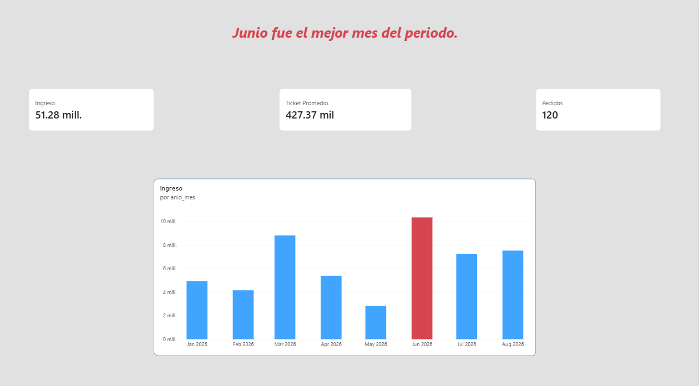
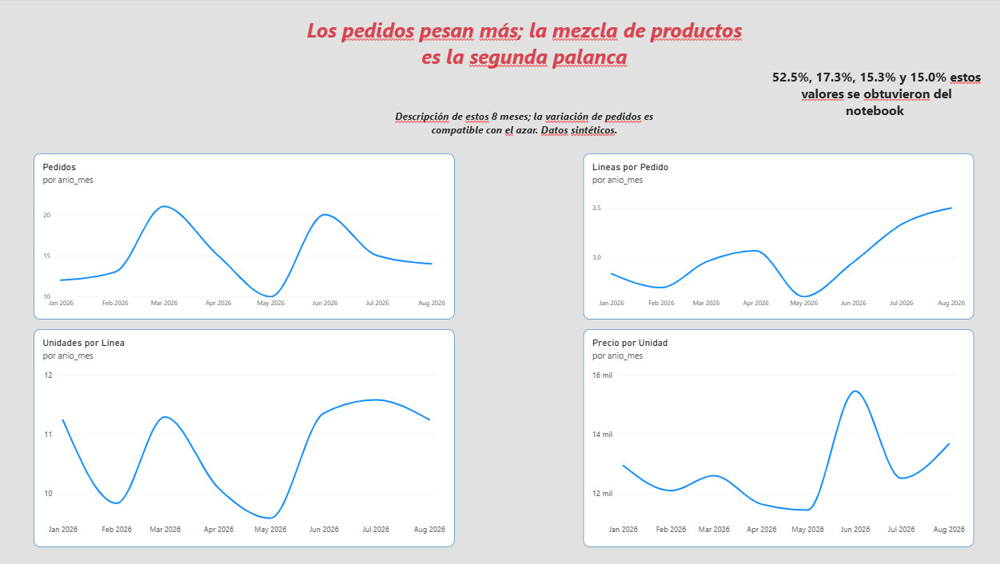
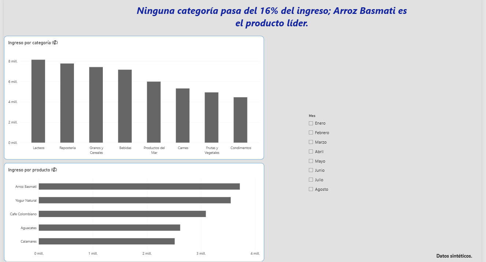
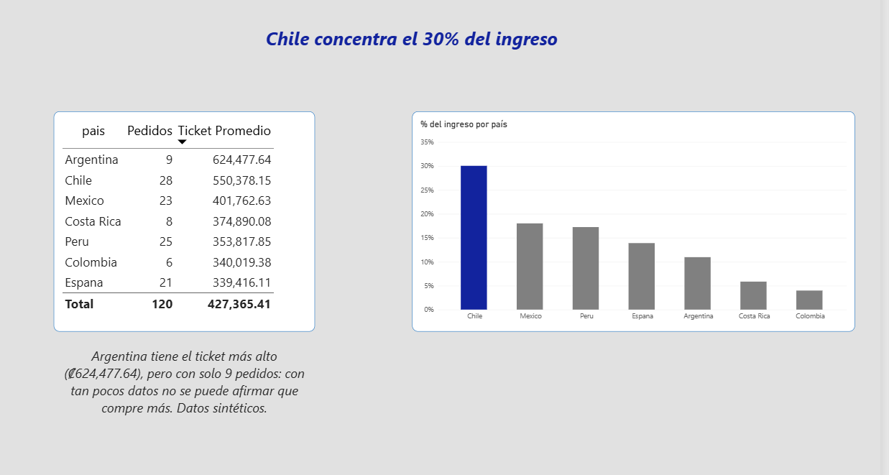

# ¿Qué explica la variación mensual del ingreso?

Pipeline ETL, modelo dimensional, SQL, análisis estadístico y dashboard en Power BI.

> **Aviso:** los datos de Northwind simplificado son sintéticos y se generaron para práctica. Los hallazgos ilustran el método; no describen un negocio real.

## Pregunta de negocio

¿Qué explica la variación mensual del ingreso entre enero y agosto de 2026: más pedidos, pedidos más grandes o una mezcla distinta de productos?

## Hallazgos principales

- La identidad contable del ingreso es **pedidos × líneas por pedido × unidades por línea × precio por unidad**. En estos ocho meses, los pedidos representan el 52.5% de la variación observada; precio por unidad (asociado a la mezcla de productos), 17.3%; líneas por pedido, 15.3%; y unidades por línea, 15.0%.
- Junio tuvo el mayor ingreso (**₡10,355,550.62**), aunque marzo tuvo más pedidos (21 frente a 20). En junio, el mayor número de pedidos y el precio por unidad más alto contribuyeron al resultado respecto al promedio del período.
- La variación mensual de pedidos es compatible con el azar en esta muestra (χ² = 6.667, p = 0.46). El ticket de junio tampoco fue significativamente mayor que el del resto (Welch p = 0.167).
- Chile concentra el 30.0% del ingreso; los tres clientes con mayor ingreso son chilenos.

La descomposición describe cómo se distribuye la variación observada; **no demuestra causas**. Las pruebas estadísticas también deben leerse con cautela: hay solo ocho meses y junio se eligió después de observar que era el mes de mayor ingreso.

## Datos

El archivo `data/northwind.db` contiene cinco tablas: Categorias (8 filas), Productos (40), Clientes (20, en 7 países), Pedidos (120, del 2 de enero al 29 de agosto de 2026) y DetallesPedido (361 líneas). El ingreso total es **₡51,283,849.07** y el ticket promedio, **₡427,365.41**.

## Pipeline y modelo dimensional

```text
data/northwind.db → extract → validate → transform → load temporal → reconcile → data/warehouse.db
                                             si falla: se conserva el warehouse anterior
```

| Etapa | Qué hace |
|---|---|
| `extract` | Lee las cinco tablas de la base de origen y falla claramente si el archivo no existe. |
| `validate` | Ejecuta 12 chequeos que rechazan datos con problemas; también reporta avisos que no bloquean el proceso. |
| `transform` | Construye las dimensiones y la tabla de hechos del modelo en estrella. |
| `load` | Escribe en un archivo temporal; publica el warehouse solo después de la reconciliación. |
| `reconcile` | Compara líneas, pedidos e ingreso con el origen y revisa las llaves foráneas. |

El grano de `fact_ventas_lineas` es una fila por línea de pedido (`detalle_id`). Las tablas de dimensión son `dim_cliente` (20 filas), `dim_producto` (40) y `dim_fecha` (240 días). El precio de cada producto se copia a sus líneas; como la fuente no tiene historial de precios, los cambios de precio unitario mensual reflejan la mezcla de productos y no cambios de precio a lo largo del tiempo.

## SQL y análisis

- [`sql/Consultas.sql`](sql/Consultas.sql): resumen mensual, ranking, variación contra el mes anterior, acumulado, categoría líder, productos principales y concentración por país.
- [`notebooks/analisis.ipynb`](notebooks/analisis.ipynb): descomposición logarítmica, prueba de dispersión, prueba t de Welch con intervalo de confianza y tamaño del efecto, y exploración de mezcla de productos.

## Dashboard de Power BI

El archivo editable es [`powerbi/dashboard_northwind.pbix`](powerbi/dashboard_northwind.pbix). Las capturas permiten revisar sus cuatro páginas sin abrir Power BI:

| Página | Mensaje |
|---|---|
|  | Junio fue el mes de mayor ingreso del período. |
|  | Los pedidos representan la mayor parte de la variación observada. |
|  | Muestra el ingreso por categoría y producto. |
|  | Chile concentra el 30% del ingreso. |

El exportador genera los CSV que utiliza Power BI en `powerbi/datos/`.

## Cómo reproducirlo en Windows

Ejecuta estos pasos desde la raíz del repositorio. Los comandos entran primero a la carpeta del proyecto, donde las rutas relativas de los scripts están configuradas:

```powershell
Set-Location .\proyecto-final-northwind
python -m venv .venv
.\.venv\Scripts\Activate.ps1
python -m pip install pandas numpy scipy matplotlib jupyter

# Genera data/warehouse.db a partir de data/northwind.db
python src\pipeline.py

# Exporta las tablas y el resumen de palancas a powerbi/datos/
python src\exportar_para_powerbi.py

# Abre el notebook desde su carpeta para que encuentre ../data/warehouse.db
Set-Location .\notebooks
jupyter notebook analisis.ipynb
```

Si PowerShell bloquea la activación, puedes invocar directamente los ejecutables del entorno. Ejecuta esto desde la carpeta del proyecto:

```powershell
.\.venv\Scripts\python.exe src\pipeline.py
.\.venv\Scripts\python.exe src\exportar_para_powerbi.py
Set-Location .\notebooks
..\.venv\Scripts\jupyter.exe notebook analisis.ipynb
```

Para actualizar el dashboard, abre `powerbi/dashboard_northwind.pbix` en Power BI Desktop y verifica que sus consultas usen los CSV recién generados en `powerbi/datos/`.

## Estructura del proyecto

```text
proyecto-final-northwind/
├── data/
│   └── northwind.db                 # Base de origen sintética
├── src/
│   ├── pipeline.py                  # ETL y reconciliación
│   └── exportar_para_powerbi.py     # Exportación de tablas a CSV
├── sql/
│   └── Consultas.sql
├── notebooks/
│   └── analisis.ipynb
└── powerbi/
    ├── dashboard_northwind.pbix
    ├── datos/                       # CSV generados para Power BI
    └── img/                         # Capturas del dashboard
```

## Limitaciones

- Datos sintéticos de un solo año, del 2 de enero al 29 de agosto de 2026; no permiten comparación interanual.
- Hay pedidos en solo 91 de los 240 días y alrededor de 15 pedidos por mes, por lo que las diferencias mensuales pueden ser ruido.
- Junio se seleccionó después de observar el mayor ingreso (análisis post hoc), lo que aumenta el riesgo de encontrar diferencias aparentes.
- La descomposición es contable y descriptiva; no identifica causas.
- La fuente asigna un solo precio por producto y no conserva historial de precios.
- El pipeline hace una carga completa y se ejecuta manualmente.

## Próximas mejoras

Agregar pruebas automatizadas con `pytest`, una carga incremental y una ejecución programada; después, repetir el análisis con datos reales.
